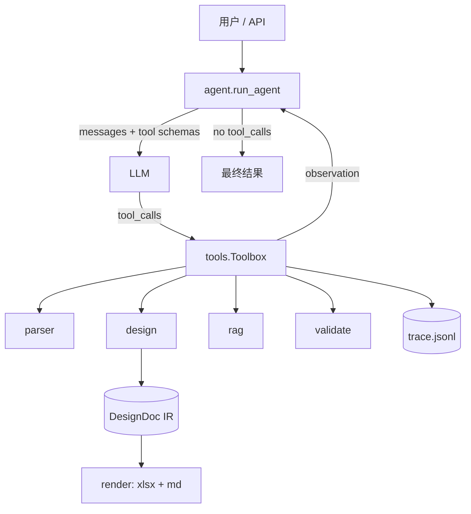

# Pipeline Design Copilot

把 UIF pipeline YAML 变成列级血缘设计文档的 Agent。

配套读物：`../Agent转型手册.md`

---

## 它是什么

输入一个 pipeline 文件，输出：

1. **`{name}-design.xlsx`** — 8 张表：Overview / Source Inventory / Landing × N / Load Targets / Transform Chain / Schema Diff / Review Notes
2. **`{name}-review.md`** — 按严重度排序的评审报告，每条带 rule id 和证据
3. **`{name}-trace.jsonl`** — 每一轮 LLM 和工具调用的完整记录

在样例文件 `fact-order-fulfillment.yaml` 上的输出：**1 条 high（7 列 schema 漂移）+ 2 条 check**，耗时约 60 ms（offline 模式）。

## 分层

```
接口层   CLI (pdc agent) / FastAPI (POST /runs)
─────────────────────────────────────────────
编排层   agent.py    ReAct 循环 + 自校验 + 预算 + trace
─────────────────────────────────────────────
能力层   tools.py    7 个工具（模型唯一的入口）
         rag.py      BM25 规则检索
         validate.py 输出校验器（确定性裁判）
─────────────────────────────────────────────
认知层   design.py   PipelineFacts -> DesignDoc(IR)
         ir.py       Sheet / Finding / DesignDoc
─────────────────────────────────────────────
数据层   parser.py   YAML -> PipelineFacts（frozen dataclass）
─────────────────────────────────────────────
```

**Mermaid 版**（贴到 GitHub 能直接渲染）：



## 核心设计决策

| # | 决策 | 理由 |
|---|---|---|
| 1 | **确定性优先**：解析/计数/比对/渲染全部代码化 | 模型数 100 列必错；把精确计算从模型手里拿走，幻觉影响面只剩"措辞" |
| 2 | **IR 中间层**：Agent 不直接写 xlsx | 渲染可单测、IR 可 diff、可人工改后重渲染、模型错也不会错在文件格式 |
| 3 | **工具带 `ok/error` 结构** | 工具失败要把异常类型喂回模型，它才知道换策略 |
| 4 | **自校验循环**（≤3 轮） | 校验器是确定性的，比模型自评可靠；3 轮后仍失败说明是结构性问题，继续只是烧钱 |
| 5 | **`offline` 模式**：同一套工具，用 SOP 代替模型 | 证明工具层与模型解耦；也是对照组——SOP 能到 100%，说明模型的价值在"判断"而非"流程" |
| 6 | **trace 落到 JSONL** | 出问题时日志没用，你要看决策链 |

## RAG：检索评测（进行中）

### 语料

| 来源 | 文档 | chunk |
|---|---|---|
| `.bob/rules-uif-etl/*.md` | 14 | 185 |
| `.bob/skills/*/SKILL.md` | 9 | 185 |
| **合计** | 23 | **370** |

必须纳入 skills：多源维度、增量加载、DDL 这些模式只写在 skill 里，
只看 rules 的话这类问题永远检索不到。

### 嵌入模型

`BAAI/bge-small-zh-v1.5`（512 维，fastembed 本地 ONNX，无需 GPU / API key）。

HuggingFace 直连会超时，国内需设镜像：

```bash
export HF_ENDPOINT=https://hf-mirror.com
```

模型只下载一次，之后缓存在 `out/rag/*.npy`，加载 < 1 秒。

### 评测方法（关键：候选池必须是并集）

```
标注池 = BM25_top5 ∪ Vector_top5
```

如果只给 BM25 的 top-k，向量检索命中的段落根本不在池子里，
标注完永远算不出向量赢在哪 —— 这是选择性偏差。

当前标注表：157 行 / 18 条 query，其中 **74 行仅向量命中、67 行仅 BM25 命中**，
说明并集策略确实生效（否则会系统性低估一方）。

指标只统计 k ≤ 5，因为池深就是 5；k 更大时可能有相关段落没进池子，
算出的 recall 会偏低。

### 怎么跑

```bash
# 1. 生成标注表（已完成）
HF_ENDPOINT=https://hf-mirror.com uv run python -m rag.label

# 2. 人工标注：打开 out/rag/label-sheet.csv，把 relevant 列填 1/0
#    同时有可读版 out/rag/label-sheet.md

# 3. 评测（BM25 / 向量 / 混合 α 扫描 / RRF）
HF_ENDPOINT=https://hf-mirror.com uv run python -m rag.eval

# 4. 只验证算法本身
uv run python -m rag.eval --self-test
```

### 评测结果（15 条可答 query）

标注方式：**LLM 初标（deepseek-chat）+ 人工抽检 3 条**，不是纯人工标注。
抽检发现 1 处漏标（q02 第 2 条），已修正；3 条 query 语料未覆盖，已排除。

| retriever | R@1 | R@3 | R@5 | MRR |
|---|---|---|---|---|
| bm25 | 0.467 | 0.667 | 0.667 | **0.604** |
| vector[bge-small-zh] | 0.133 | 0.333 | 0.333 | 0.258 |
| hybrid[zh](α=0.5) | 0.267 | 0.467 | 0.733 | 0.437 |
| **vector[bge-small-en]** | 0.533 | 0.733 | 0.733 | **0.664** |
| **hybrid[en](α=0.1)** | 0.467 | 0.800 | **0.933** | 0.638 |
| hybrid[en](α=0.7) | 0.533 | 0.733 | 0.800 | 0.669 |

**三个结论：**

1. **模型选型的影响 > 算法选择。** 同一个向量检索，中文模型 R@5=0.333，
   英文模型 R@5=0.733 —— 差 2.2 倍。用错模型的"向量检索"比 BM25 还差。

2. **混合检索在 α 偏向量时 R@5 最优。** α=0.1（即 90% 向量 + 10% BM25）
   拿到 R@5=0.933，比 BM25 基线 **+40%**。

3. **指标不同，最优 α 不同。** R@5 最优在 α=0.1，MRR 最优在 α=0.7。
   说明"调参"必须先定义清楚优化目标，否则 α 是个没有意义的数字。

这直接反驳了"上向量就更好"的直觉，也是这个项目最值钱的一条实测结论。

### 端到端验证：检索变好，Agent 变好了吗？

把最优检索（hybrid α=0.1）接进 `search_rules`，同一流水线各跑 **5 次**。

| 指标 | BM25 (n=5) | Hybrid α=0.1 (n=5) |
|---|---|---|
| 引用规则数 mean±std | **1.60 ± 0.55** | 1.20 ± 1.30 |
| 其中被检索到 mean±std | 1.60 ± 0.55 | 1.20 ± 1.30 |
| 至少引用一条的比例 | **5/5** | 3/5 |
| 输入 token mean±std | 35,661 ± 5,447 | 36,109 ± 2,341 |

原始值：

```
bm25    citations = [1, 2, 1, 2, 2]
hybrid  citations = [2, 0, 1, 0, 3]
```

**结论：检索指标提升 40%，端到端没有体现出来。**

差值 +0.40，标准误 0.63，t = 0.63（|t| < 2），
在这个样本量下**看不出差异**；而且 hybrid 的方差是 BM25 的 2.4 倍。

这是一个反直觉但真实的结果。可能的解释：

1. **引用数取决于 prompt，不取决于检索。** 模型引不引用一条规则，
   主要由"要求引用"这条指令驱动，检索给什么影响很小。
2. **更好的 chunk 不等于更多的引用。** 检索到对的段落，模型可能直接用了内容
   而不写引用。
3. **n=5 太小。** hybrid 的标准差 1.30，要检出 0.4 的差异需要几十次运行。

**所以这个改动不该上线。** 检索 benchmark 上的 40% 提升没有转化成可观测的用户价值，
上线只是增加复杂度和 370 个向量的维护成本。

这比"我把检索提升了 40%"是更可信的结论——它证明你真的验证了改动有没有用，
而不是改完就宣布胜利。

### 两个测量 bug（都是这次跑出来的）

**1. `degraded` 和 `disabled` 混为一谈。**
A/B 脚本给 bm25 组设 `PDC_RAG_MODE=bm25`，结果它被标记为 `degraded=True`，
汇总时报"结果不可信"。实际上这是正常配置，不是加载失败。
已拆成两个字段，并加了断言测试。

**2. trace 截断导致 `retrieved_chunks=0`。**
tracer 把工具返回值截断成 2,000 字符的字符串，分析脚本按 list 解析拿不到 id，
看起来像"两路都没检索到"。把工具输出的上限提到 50,000 并兼容字符串形态才修好。

这两个 bug 都只有端到端跑才能暴露，单测覆盖不到。

### 语料缺口

3 条 query 在 370 个 chunk 里找不到答案，判定为真实缺口而非检索失败：

- `MCP 是什么，解决什么问题` —— 文档里只有工具的用法，没有协议本身的定义
- `UT 是什么，和维度有什么关系` —— 术语表里没有 UT 条目
- `credentials 和 connector 有什么区别` —— 只在 YAML 例子中出现，没有语义解释

这三条应该补进知识库，不是调检索。

### 已发现的真问题

**中文 query 撞英文语料。** 最初的 18 条全是中文，结果 `多源维度该怎么加载`
在 185 个 chunk 里一条都对不上——因为 `.bob` 文档全是英文，BM25 按字切分中文，
语义和字面都断开了。

改成中英混合后（`how to load a dimension that has multiple source systems`），
`skill-independent-dimension-pattern#When to Use This Skill` 直接 BM25 命中第一名。

**这本身就是结论**：这个团队是"文档英文、人问中文"，检索方案必须能跨语言，
单靠 BM25 不行，需要多语向量模型（bge-m3）或查询改写。

### 自检抓到的 bug

`--self-test` 第一次跑就抓到我把 MRR 手算错了（写成 0.5，实际 0.5556）。
指标算法的错误比检索效果的错误更危险，因为它会影响所有结论。

---

## 并发与压测

Agent 单次运行 12 秒、7 次模型调用。不做并发控制，20 个用户就会同时打 140 个请求出去。

### 实现

`pdc/concurrency.py` 用 `Condition` + 计数器实现有界并发（**不要用 `Semaphore` + `wait_for(timeout=0)` 做非阻塞获取**，
`wait_for` 在 timeout<=0 时会立刻取消，导致 100% 拒绝 —— 这个坑我踩了）。

两种排队策略：

| 策略 | 行为 | 适用 |
|---|---|---|
| `wait` | 排队等待 | 后台批处理，保成功率 |
| `reject` | 立刻 429 | 在线请求，保延迟 |

### 压测结果（mock，单次 1.2s，服务端上限 4）

**wait 策略** —— 吞吐饱和，延迟随排队增长：

| 客户端并发 | p50 | p95 | 吞吐 | 错误 |
|---|---|---|---|---|
| 1 | 1229ms | 1304ms | 0.83/s | 0% |
| 4 | 1164ms | 1309ms | 3.27/s | 0% |
| 8 | 1253ms | 4908ms | 3.24/s | 0% |
| 16 | 3032ms | 4861ms | 3.29/s | 0% |
| 32 | 3033ms | 4959ms | 3.19/s | 0% |

吞吐稳定在 **3.2/s ≈ 4 / 1.2s**（Little's Law），p95 在并发 8 之后跳到 5 倍。

**reject 策略** —— 保住延迟，拒绝 75%：

| 客户端并发 | p50 | p95 | 错误率 |
|---|---|---|---|
| 4 | 1227ms | 1317ms | 0% |
| 8 | 0ms | 1203ms | 75% |
| 16 | 0ms | 1169ms | 75% |

### 真实链路（DeepSeek，4 并发）

```
count=4  ok=4  errors=0
p50=11614ms  p95=12982ms  p99=13171ms  throughput=0.30/s
```

单次运行 13.0s，4 并发 13.2s —— **线性扩展，无争用**。
理论吞吐 4/13.2 = 0.303/s，实测 0.30/s，误差 1%。

### SSE 流式

`GET /runs/stream` 每完成一步推一条事件，首字节从 12s 降到约 300ms：

```
data: {"index":1,"kind":"llm","name":"rule-based","latency_ms":0}
data: {"index":2,"kind":"tool","name":"list_pipelines","latency_ms":59}
...
data: {"kind":"done","run_id":"...","files":{...}}
```

---

## 可靠性层（幻觉 / 测试 / 权重）

这是"能演示"和"能上生产"的分界。三层递进，缺一不可。

### 第一层 预防

| 手段 | 在哪 |
|---|---|
| 工具优先于记忆，所有事实来自工具 | `tools.py` 的 description 里写死"禁止自行数数" |
| 精确计算不交给模型 | `checks.py` / `grounding.py` 全部是代码 |
| 事实不足时输出 `not asserted` | `SYSTEM_PROMPT` 第 6 条 |

### 第二层 检测（`pdc/grounding.py`）

把文档里的每一条断言拉回可验证的事实，四类检查：

| code | 检查什么 | 对应的幻觉模式 |
|---|---|---|
| `unknown_rule` | 引用的 rule id 必须真实存在 | 编一个看起来很像的规则名 |
| `ungrounded_column` | 提到的列名必须在解析结果里 | 编一个合理的列名 |
| `number_mismatch` | "N 列" 必须等于清单实际条数 | 数字随口说 |
| `missing_evidence` | 证据路径必须存在 | 编造出处 |

**关键**：它不是判断"说得对不对"，而是判断"能不能被事实支持"。业务对错要人，可追溯性要工程。

### 第三层 兜底

- 检测失败不阻断整体，但该条 finding 标记为 unverified
- 评测里 grounding < 0.999 直接判 FAIL（宁可误报，不可放过）

### 测试的三个层次

| 层次 | 文件 | 抓到了什么真实 bug |
|---|---|---|
| 单元 | `test_parser.py` / `test_design.py` / `test_llm.py` | `openai` 包未安装，`--mode auto` 一跑就崩 |
| 对抗 | `test_adversarial.py` | `schema: Template`（1,522 个文件）、extract 无 alias，解析器直接抛异常 |
| 评测 | `eval/` | 多 load object 场景出不了落地表 |

单元测试证明"按设计工作"，对抗测试证明"坏输入不崩"，评测证明"整体达标"。
三者缺一，面试时都会被问穿。

### 权重

三个不同层面的权重，别混为一谈：

| 层面 | 这里怎么做的 |
|---|---|
| **评测加权** | `pdc/scoring.py`：structural .15 / contract .25 / detection .20 / **grounding .30** / stability .10。grounding 最高，因为"编造"比"格式丑"危险 |
| **检索融合** | 目前只有 BM25；升级时 `score = α·bm25 + (1-α)·vector`，α 用标注样本调 |
| **模型权重（微调）** | 不在本项目范围。Agent 工程师通常不训模型，只做 prompt / 工具 / 路由 |

两个可调开关：

```bash
pdc eval --weights structural=0.2,grounding=0.5   # 改权重
pdc eval --sabotage                                # 注入幻觉，验证检测器有效
```

`--sabotage` 会往一条 case 里塞伪造的 finding，预期 4 类 violation 全部命中、
该 case 判 FAIL、加权分从 1.0 掉到 0.9907。**指标全 1.0 的评测没有说服力，
能证明它会掉分才有。**

### 校准（最容易被问倒的一条）

系统分和人工分必须对齐，否则分数是假的：

```python
from pdc.scoring import calibrate
calibrate(system_scores=[0.95, 0.8, 1.0], human_scores=[0.8, 0.85, 0.9])
# -> {'mae': 0.0833, 'bias': 0.04, 'verdict': '基本校准'}
```

bias 为正 = 系统过于自信（危险），为负 = 过于保守（浪费人工）。

---

## 真实模型运行记录（DeepSeek, 2026-11-18）

| 流水线 | 域 | steps | 工具调用 | LLM 调用 | 输入 tok | 输出 tok | 耗时 | 错误 |
|---|---|---|---|---|---|---|---|---|
| pipeline-a | fact | 17 | 10 | 7 | 40,796 | 1,542 | 13.0s | 0 |
| pipeline-b | fact | 20 | 13 | 7 | 45,850 | 1,560 | 12.5s | 0 |
| pipeline-c | dimension | 18 | 10 | 8 | 36,814 | 1,313 | 12.5s | 0 |
| **合计** | | 55 | 33 | 22 | 123,460 | 4,415 | 38s | 0 |

> 名称已脱敏：原始流水线来自内部仓库，这里只保留指标。

成本（deepseek-flash 峰值价 $0.30/M in, $1.20/M out）：**约 $0.014 / 次，三次合计 $0.042**。

### 三个观测结果

**1. 确定性核心不受模型影响**

`offline` 和 `auto` 两次运行的 xlsx 结构逐表比对：

```
offline: {'Overview': (17,2), 'Source Inventory': (16,8), 'Landing - eid': (34,7), ...}
auto   : {'Overview': (17,2), 'Source Inventory': (16,8), 'Landing - eid': (34,7), ...}
结构一致: True
```

8 张表，行列数完全相同。模型只改变了叙述，没有改变数据。

**2. 模型确实会拒绝无依据的断言**

第一次运行的原文：

> "`datamart-parquet` 的 25 列 vs eid 的 33 列 —— 这个差异我没有单独下结论。
> diff_schema 在 job_index=1 处因下游无 schema 而跳过，所以'少了 8 列'这个数字**没有工具背书**，我不写进文档。"

这就是 prompt 里 "not asserted" 生效的证据。

**3. 同一输入两次，叙述质量有差异**

第一次运行把 `diff_schema` 的方向搞混了，写了一段"这是矛盾"的困惑；
第二次运行正确理解了"帧 vs 下游 schema"的方向。IR 完全一致，只是措辞不同。

结论：**概率性部分的方差只能靠约束压缩，不能消除。** 所以架构上必须让模型只做判断，不做计算。

### 引用审计（防编造）

`pdc/citations.py` 会扫描模型输出里的 `文件#锚点` 引用并回查：

```
run-a    anchors=3 problems=0
run-b    anchors=4 problems=0
run-c    anchors=0 problems=0
合计: 7 个引用, 0 个问题
```

7 个引用全部真实存在，0 编造。其中 1 个是截断（真实标题比引用更长，
模型写 `Surrogate Keys`），按"截断可接受、添油加醋不可接受"的非对称规则放行。

这条非对称规则是刻意的：宁可放过截断，也要抓住编造。

---

## 两种运行模式：一个说明"为什么它是 agent"，一个说明"AI 值多少"

| | `pdc agent <file>` | `pdc audit <dir>` |
|---|---|---|
| 任务 | 目标固定：为这个文件生成文档 | **目标开放**：这个目录有什么问题 |
| 看哪些文件 | 只有一个 | **模型自己决定** |
| 什么时候停 | 文档校验通过 | **模型说够了** |
| 能否写 SOP | 能（`--mode offline` 已验证） | **不能** |
| 产出 | 8 张表的文档 | 审计报告 + 自检驳回记录 |

**`audit` 没有 offline 版本，这不是偷懒。** 因为"先看哪个、看几个算够"写不出固定流程——
这正是"真 agent"和"工作流"的分界线。

### 实测（真实模型，同一目录两次）

```
第 1 次：13 步，4 个文件，发现 3 条
第 2 次：10 步，4 个文件，发现 4 条
```

**步数和顺序都不同**，因为路径不是写死的。

```bash
export OPENAI_BASE_URL=https://api.deepseek.com
export OPENAI_API_KEY=sk-...
uv run pdc audit samples/pipelines
```

### generator-critic：让它查自己

审计循环产出的每条结论都要过一道核查。但核查**按证据来源分流**：

| basis | 含义 | 是否核查 |
|---|---|---|
| `tool` | 数字来自 `diff_schema` 等工具 | **跳过** |
| `file` | 模型自己读文件看出来的 | **核查** |

这个分流是被一次事故逼出来的：第一版让 critic 核查所有结论，
它用"读 YAML 数一数"的方式去核实"7 列未声明"，结果自己数错了，
**把真问题驳回了**。

规则是：**确定性工具算出的数字不需要模型复核，模型自己读出来的才需要。**

被驳回的结论不会消失，会单独列在报告的「自检驳回」一节——保留证据链。

---

## 部署

> 关键问题：本地依赖外部数据仓库（私有仓库），容器里没有这个路径，
> 所有工具都会 `FileNotFoundError`。所以把 4 条流水线 + 14 篇规则 + 9 个 skill
> 打包进了 `samples/`（708 KB），容器自带数据，不依赖外部仓库。

### 三种方式

**1. 本地 Docker（最快验证）**

```bash
docker compose up --build
curl localhost:8000/health
```

**2. Fly.io（有免费额度）**

```bash
curl -L https://fly.io/install.sh | sh
fly auth signup          # 或 fly auth login
fly launch --no-deploy --copy-config --name pipeline-copilot-<你的名字>
fly deploy
```

**3. Railway（连 GitHub 即可）**

推仓库 → New Project → Deploy from GitHub → 自动用 Dockerfile → 生成域名。

### 环境变量

| 变量 | 默认 | 说明 |
|---|---|---|
| `PDC_REPO` | `samples/pipelines` | pipeline yaml 目录 |
| `PDC_RULES_DIR` | `samples/rules` | 规则文档 |
| `PDC_SKILLS_DIR` | `samples/skills` | skill 文档 |
| `PDC_OUT_DIR` | `out` | 产物目录（挂到 `/files` 可下载） |
| `PDC_RAG_MODE` | `bm25` | `bm25` 或 `hybrid`（hybrid 需下载 100MB 模型） |
| `PDC_RAG_ALPHA` | `0.1` | 混合检索权重 |
| `PDC_MAX_CONCURRENCY` | `4` | 并发上限，满了返回 429 |
| `OPENAI_BASE_URL` / `OPENAI_API_KEY` | — | 接真实模型时才需要 |

容器里默认 `PDC_RAG_MODE=bm25`，避免启动时下载模型。要 demo 混合检索就改成 `hybrid`。

### 已验证的容器行为

用完全模拟容器的环境变量（不依赖本机 CRD 仓库）跑通：

```
GET  /health                        → 200，paths 指向 samples/
POST /runs  {mode: offline}         → 200，15 steps，0 issues
GET  /files/xxx-design.xlsx         → 200，19,795 bytes
```

### 端点

| 方法 | 路径 | 说明 |
|---|---|---|
| GET | `/health` | 健康检查 + 当前并发 + 路径解析结果 |
| POST | `/runs` | 发起生成，满载返回 429 |
| GET | `/runs/{id}` | 取结果 |
| GET | `/runs/stream` | SSE 流式推每一步 |
| GET | `/files/{name}` | 下载生成的 xlsx / md |

---

## 快速开始

```bash
cd ~/Desktop/Agent\ Learning/pipeline-copilot

# 0. 跑测试（22 个）
~/.local/bin/uv run pytest -q

# 1. 只解析，不生成
~/.local/bin/uv run pdc parse \
  samples/pipelines/fact-order-fulfillment.yaml --diff

# 2. 确定性生成（完全不用模型）
~/.local/bin/uv run pdc design \
  samples/pipelines/fact-order-fulfillment.yaml

# 3. 完整 Agent 循环（offline：SOP 驱动）
~/.local/bin/uv run pdc agent fact-order-fulfillment.yaml --mode offline

# 4. 接真实模型
export OPENAI_API_KEY=sk-...
export OPENAI_BASE_URL=https://api.deepseek.com/v1      # 或任何 OpenAI 兼容网关
~/.local/bin/uv run pdc agent fact-order-fulfillment.yaml \
  --mode auto --model deepseek-chat

# 5. 评测
~/.local/bin/uv run pdc eval

# 6. 起服务
~/.local/bin/uv run uvicorn pdc.api:app --port 8000
```

## 当前评测结果

```
[PASS] spend-details        sheets= 8 landings=2 findings=3  62ms
[PASS] forecast-source      sheets= 6 landings=0 findings=1  28ms
[PASS] forecast             sheets= 8 landings=2 findings=3  72ms
[PASS] planning-activity    sheets=10 landings=4 findings=6  76ms
[PASS] planning-overrides   sheets= 8 landings=2 findings=2  22ms
[PASS] spend                sheets= 8 landings=2 findings=5  29ms
[PASS] budget               sheets= 8 landings=2 findings=6  41ms
[PASS] spend-details-2      sheets= 8 landings=2 findings=3  59ms

structural_rate 1.0   contract_rate 1.0   detection_rate 1.0   stability 1.0
```

四个指标的含义：

| 指标 | 定义 | 怎么测 |
|---|---|---|
| structural | 文档结构完整（sheet 数、landing / load targets 存在） | 结构断言 |
| contract | 渲染出的 xlsx 与 IR 完全一致，无公式注入 | `validate_doc` |
| detection | 已知缺陷被检出 / 干净文件不误报 | 每个 case 的 `expect_finding` |
| stability | 同输入两次结果一致 | 重复 case 对比 |

## 目录

```
pdc/
  models.py    frozen dataclass：Column / ExtractSpec / TransformSpec / LoadSpec / JobSpec / PipelineFacts
  parser.py    YAML -> PipelineFacts
  checks.py    schema_diff / dropped_and_renamed / numbering
  ir.py        Sheet / Finding / DesignDoc
  design.py    PipelineFacts -> DesignDoc（纯函数）
  render.py    DesignDoc -> xlsx / md
  validate.py  输出校验
  rag.py       BM25 检索（零依赖实现）
  llm.py       Protocol + OpenAI 兼容客户端 + ScriptedLLM + RuleBasedLLM
  tools.py     7 个工具 + JSON Schema + 分发
  agent.py     run_once / run_agent / run_with_self_check
  trace.py     JSONL tracer
  api.py       FastAPI
eval/
  cases.py     真实用例 + 人工核对过的期望
  run.py       评测运行器 + 四指标
tests/
  test_parser.py   8 个（解析、真实缺陷回归）
  test_design.py   9 个（IR、渲染、校验、注入）
  test_agent.py    5 个（循环、工具失败、最大步数、自校验重试）
```

## 工具清单

| 工具 | 类型 | 为什么必须是工具 |
|---|---|---|
| `list_pipelines` | 读 | 5592 个文件，不能全塞 context |
| `inspect_pipeline` | 读 | 单文件 949 行，抽取后只留 2k token |
| `diff_schema` | 算 | 精确比对，模型算不准 |
| `search_rules` | 读 | 按需检索，这就是 RAG |
| `build_design` | 算 | IR 构建，纯函数 |
| `write_document` | 写 | 有副作用，模型不能直接做 |
| `validate_document` | 算 | 确定性裁判，Agent 的"后果感知" |

## 已知限制（接下来的练习）

| # | 限制 | 练习 | 难度 |
|---|---|---|---|
| 1 | `build_design` 只输出列名，不解析 SparkSql 的 SELECT 列表 | 从 SQL 抽输出列，这样没有 schema 也能推导帧结构 | ★★ |
| 2 | `RuleBasedLLM` 的 SOP 写死，不会根据 validate 结果改策略 | 让它读取 issues 并决定重试 | ★★★ |
| 3 | `POST /runs` 同步执行，长任务会超时 | 换 BackgroundTasks + 状态表 + 轮询 | ★★★ |
| 4 | 没有向量检索，只有 BM25 | 加 embedding + RRF 融合，用 eval 证明提升 | ★★★★ |
| 5 | `derive_findings` 只有 6 条规则 | 从 `.bob/skills/design-review` 把 checklist 全部转成规则 | ★★★ |
| 6 | 没有前端 | 用 React 画 trace 时间线（你的强项） | ★★★ |

做完 1、5、6，这个项目就可以直接写进简历并现场演示了。

## 下一步

M1 的目标不是"让模型写得更好"，而是**让模型只做判断**：
- 哪条 finding 值得写进评审、用什么措辞
- 哪些列需要业务说明
- 哪些问题是结构性的（该停下来找人）vs 可自动修的

参考手册 3.10 节（自校验）和 4.7 节（常见坑）。
